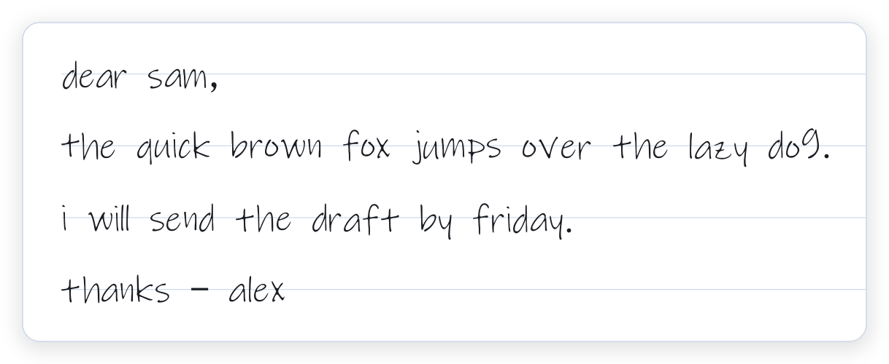
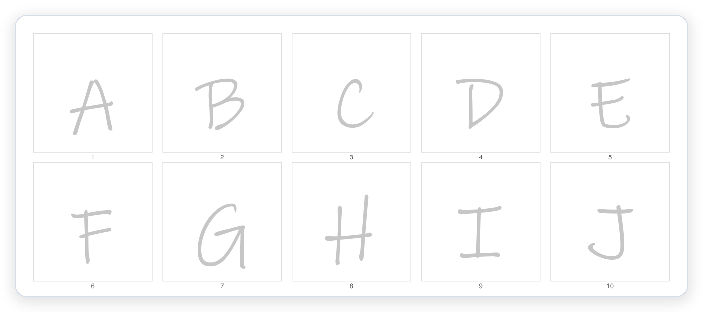
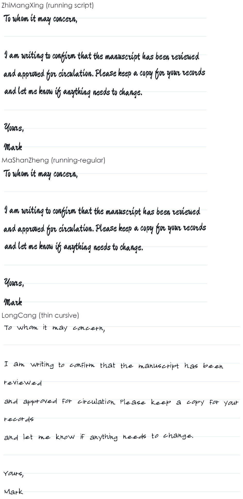
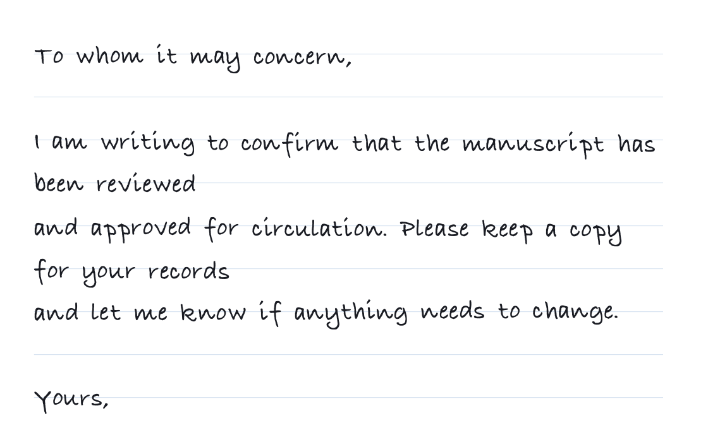

<h1 align="center"> handwriting-pdf</h1>

<p align="center">
  <b>Turn the handwriting in a photo into a printable, typeset manuscript</b><br>
  <sub>photo / scan / PDF → your own font (.ttf) → a laid-out PDF｜fully local, no network｜Codex · DeepSeek Harness skill</sub>
</p>

<p align="center">
  
  
  
  
</p>

<p align="center"><sub><a href="README.md">中文</a> · <b>English</b></sub></p>

<p align="center">
  
</p>
<p align="center"><sub>Example: 26 letters turned into a font, then used to set a letter — ruled paper, per-line jitter, adjustable ink</sub></p>

## What it solves

Most "handwriting generators" just swap in a built-in handwriting font — your upload never takes part in the output. This one is the other way round: **it traces your handwriting into vector outlines and builds a real `.ttf` from them**, then typesets with that font.

- **Real strokes** — each character traced and vectorised, not a font skin.
- **Reusable** — font plus layout defaults freeze into one profile, so the next run is one sentence.
- **Fully local** — no network, no upload; photos, fonts and PDFs stay on your machine.

## Three steps to a document

```powershell
hwpdf template --text-file letter.txt -d hw            # 1) a practice sheet for the unique characters in the text
hwpdf scan hw/page1.jpg -d hw                          # 2) photo → corner markers → perspective fix → cut cells
hwpdf font -d hw --family "My Hand" -o hw/font.ttf     # 3) vectorise into a TrueType font
hwpdf render --font hw/font.ttf --text-file letter.txt -o hw/letter.pdf
```

<p align="center">
  
</p>
<p align="center"><sub>The sheet is generated by the tool: light grey guide characters plus black corner markers (a tilted photo is straightened automatically); cells map one-to-one to characters, so nothing is misread</sub></p>

Printing tips: **A4 / 100% scale**, a dark pen (0.5 mm+), one character per cell, keep all four corner markers in frame.

## Two sources of style

<p align="center"></p>

| Source | How | Good for |
|---|---|---|
| **Ready-made font** | `hwpdf fonts` lists the catalogue, `hwpdf fonts --fetch zhimangxing` downloads one (OFL-1.1, commercial use and embedding allowed), `hwpdf render --font-name 志莽行书` | You want a good-looking hand without writing a sample |
| **Your sample** | practice sheet → `hwpdf scan` → `hwpdf font` → `hwpdf profile save`; missing characters are filled by `synth` from your sample | You want it to **look like you** |

Both share the same renderer and layout. The three blocks above are the same letter with nothing but the font itself — **no seam, because every glyph comes from that font**. `--font` takes any TTF/OTF/TTC (including a font you made elsewhere); `--font-name` only knows the three in the catalog.

Either path first measures **writing habits** — slant, stroke weight, ink width, layout jitter — from the font itself, or from your sample:

```bash
hwpdf habits --font-name 志莽行书           # measure: slant / ink width / suggested jitter
hwpdf profile save --name my-hand --font-name 志莽行书   # save a profile; jitter defaults to the measurement
hwpdf render --profile my-hand --text-file doc.txt -o out.pdf
```

With no `--jitter` the measured value is used: a typeset face (Hei/Song) lands around 0.35, a real running script 1.5–2.0.

## Write a few characters, set a whole page

`synth` estimates slant, stroke weight and proportions from the characters you wrote, then stamps them onto a system skeleton — so characters you never wrote still come out in your manner. Pure CPU, no download.

<p align="center"></p>

- One command: `hwpdf synth build --style your-hand.ttf --charset cjk -o synth.ttf` (3755 characters in about 10 s)
- It is **not** style transfer: structure comes from a system skeleton, only your slant, stroke weight and proportion are carried over
- A real model can be plugged in through `--engine external --provider`
- Synthesised letters read convincingly here because the Latin skeleton (Bradley Hand) is itself a handwriting face; the seam is more visible for Chinese (see Limits)
- Details, measured numbers and known limits: [docs/poc/stylefit.md](docs/poc/stylefit.md)

## Three kinds of input, most reliable first

| Input | Command | Notes |
|---|---|---|
| **Photo of a practice sheet** (recommended) | `scan` | cell coordinates map to characters one-to-one; no OCR, so no misreadings |
| A PDF that already contains handwriting | `extract-font` / `pdf-specimen` | tries the embedded font first; otherwise harvests glyphs from the page, labels from the text layer |
| A casual handwriting photo | `segment` + `label` | no printing needed, but joined/cursive characters are hard to split and need review |

## Install

```bash
npx skills add atlasmarkz/handwriting-pdf@handwriting-pdf -g -y
```

Or clone and install locally (private venv, launcher, copied into both host directories):

```powershell
powershell -ExecutionPolicy Bypass -File .\install.ps1            # DSH + Codex
powershell -ExecutionPolicy Bypass -File .\install.ps1 -Target dsh # DSH only
```

```bash
bash install.sh            # macOS / Linux, installs into both by default
```

## Common commands

Beyond the three steps above:

| Command | What it does |
|---|---|
| `hwpdf doctor` | check dependencies and system fonts |
| `hwpdf coverage --font f --text-file doc.txt` | list missing characters |
| `hwpdf render --font f --text-file doc.txt -o out.pdf` | also takes `--paper`, `--jitter`, `--ink`, `--size`, `--font-name` |
| `hwpdf profile save --name me --font f` | freeze a handwriting profile, with a `PROMPT.md` |
| `hwpdf preview --pdf out.pdf -d dir` | PDF → PNG for a quick look |

Optional second engine (`synth`, experimental, no real model wired in yet):

| Command | What it does |
|---|---|
| `hwpdf synth doctor` | check engines, weights, cache directory; exits non-zero with hints when nothing is ready |
| `hwpdf synth build --style hand.ttf --charset cjk [--weight N] -o s.ttf` | infer unwritten glyphs → reuse vectorisation → TTF (`--charset` accepts `ascii`/`digits`/`alpha`/`cjk`/`common3500`/`@file`/a literal string) |
| `hwpdf synth extend --font s.ttf --chars "龘"` | add only the new characters, the rest rebuilt from cache (about 2 s) |
| `hwpdf synth verify --font s.ttf [--charset cjk]` | report coverage: which characters still need the fallback |
| `hwpdf synth specimen --font s.ttf --real real.ttf -o sheet.png` | side-by-side sheet (left: yours; right: inferred) to eyeball before running a model |
| `hwpdf profile save --name me --font real.ttf --synth-font s.ttf` | bind the synth font into a profile; `render --profile me` then fills gaps, and `--grow` adds characters in place |
| `hwpdf synth bench --style hw/font.ttf` | time one glyph, extrapolated to 1000 / 3755 characters (CPU budget) |
| `hwpdf synth eval --font s.ttf --real real.ttf -o report.md` | evaluation report: coverage, quality gate, verbatim-reuse IoU, whether slant and weight really made it through |

Experimental scripts (need torch, run as `python scripts/…`): `train_learned.py` trains a 192k-parameter model on your own glyphs (CPU only, about 2 minutes), `train_vecwarp.py` predicts a **displacement field plus stroke width** from the same data (sharp at 320px — see [docs/poc/vector-model.md](docs/poc/vector-model.md)), and `bench_handwriting.py` runs a held-out benchmark on real OFL handwriting fonts (`--vecwarp` adds a vector-model row).

Development / regression:

```bash
python -m unittest discover -s tests -v     # 69 tests, about 2.4 s, no torch needed
```

## Limits and privacy

- **One shape per character**: no joining strokes, no allographs, no pen pressure or ink density; line and baseline jitter are simulated.
- **The font only covers what you wrote**: for Chinese text you write every unique character (30 cells per page); missing characters fall back to a system face with a warning. `synth` fills gaps from your sample, but it is an **analytic** baseline (stylefit: measure slant/weight/proportion, stamp onto a system skeleton; pure CPU) — not style transfer, and synthesised glyphs sit next to real ones with a visible seam (see [docs/poc/stylefit.md](docs/poc/stylefit.md)). A real few-shot diffusion model (`diff-font`) still lacks weights and a licence; the interface is ready.
- **Fully local**: `hwpdf` makes no network requests and has no telemetry; photos, fonts and PDFs never leave the machine. The repository ships no model weights; `diff-font` needs weights placed in `~/.handwriting-pdf/models/` (`HWPDF_MODEL_DIR` overrides), and most candidate weights have no clear licence (see [PLAN.md](PLAN.md) §8 S4), so none are bundled.
- The PDF keeps a real text layer (searchable and copyable).
- For personal documents in your own hand only; not for signatures, contracts, receipts or ID documents.

## License

MIT. The technical selection and staged plan for few-shot style transfer live in [PLAN.md](PLAN.md).
