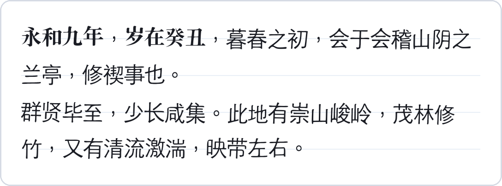
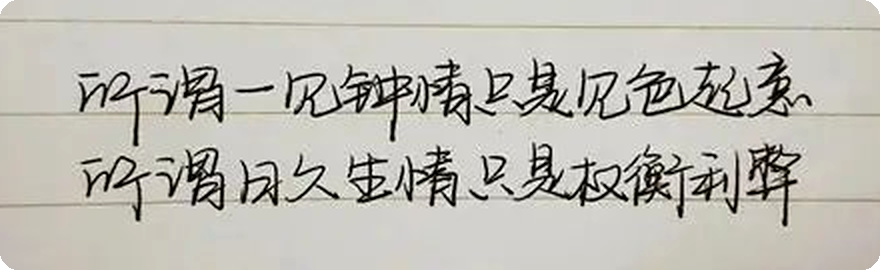

<h1 align="center"> handwriting-pdf</h1>

<p align="center">
  <b>把照片里的字迹，变成一份能打印的手写稿</b><br>
  <sub>照片 / 扫描 / PDF → 你自己的字体（.ttf）→ 排好版的 PDF｜全程本地，不联网｜Codex · DeepSeek Harness skill</sub>
</p>

<p align="center">
  
  
  
  
</p>

<p align="center"><sub><b>中文</b> · <a href="README.en.md">English</a></sub></p>

<p align="center">
  
</p>
<p align="center"><sub>示例：一句随手写的话，用一款 OFL 手写字体（马善政行楷）排出来——横线纸、逐字倾斜、墨色可调；换成你自己做的字库，就是你的笔迹</sub></p>

## 它解决什么

大多数"手写生成器"只是换一套内置手写字体——你上传的字迹并不参与生成。这里反过来：**把你的手写描摹成矢量轮廓，做成一套真正的 `.ttf`**，再用它排版。

- **真笔迹** —— 逐字取形、矢量化，不是换皮。
- **可复用** —— 字体 + 版式默认值可固化成一个 profile，下次一句话复现同一套字。
- **全本地** —— 不联网、不上传；照片、字体、PDF 只留在你机器上。

## 三步出稿

```powershell
hwpdf template --text-file letter.txt -d hw            # 1) 按正文"去重后的字"生成练习纸
hwpdf scan hw/page1.jpg -d hw                          # 2) 拍照 → 四角定位 → 透视矫正 → 按格取字
hwpdf font -d hw --family "My Hand" -o hw/font.ttf     # 3) 矢量化成 TrueType 字体
hwpdf render --font hw/font.ttf --text-file letter.txt -o hw/letter.pdf
```

<p align="center">
  
</p>
<p align="center"><sub>练习纸由工具生成：浅灰描红字 + 整页四角的黑色定位块（拍照歪了自动矫正）；格子与字符一一对应，所以不会认错字</sub></p>

打印要点：**A4 / 100%（实际大小）**，深色笔（0.5 mm+），每格一个字，照片里四角黑块要完整。

## 两种风格来源

<p align="center"></p>

| 来源 | 怎么用 | 适合 |
|---|---|---|
| **预制字体** | `hwpdf fonts` 列出目录，`hwpdf fonts --fetch zhimangxing` 下载（OFL-1.1，可商用可嵌入），`hwpdf render --font-name 志莽行书` | 想要好看的字，不想写样本 |
| **你的样本** | 练习纸 → `hwpdf scan` → `hwpdf font` → `hwpdf profile save`；缺字由 `synth` 按你的样本补 | 想让它**像你写的** |

两条路共用一套渲染与版面。排版前都会先量**书写习惯**——倾角、笔重、字宽、抖动——预制字体量的是字体本身的节奏，你的样本量的是你的：

```bash
hwpdf habits --font-name 志莽行书                        # 量一遍：倾斜 / 字宽 / 抖动建议
hwpdf profile save --name 我的字 --font-name 志莽行书     # 存成 profile，抖动自动取测量值
hwpdf render --profile 我的字 --text-file doc.txt -o out.pdf
```

`--jitter` 不给时用测量值：排版体（黑体/宋体）约 0.35，真实行书约 1.5–2.0。`--font` 接受任何 TTF/OTF/TTC（包括你在别处做好的字库），`--font-name` 只认目录里这三款。

<p align="center"></p>

上图是"你的样本"的真实输入：手机随手拍的一行字。工具会逐字切出来、描成轮廓、做成 `.ttf`——但**连笔和低分辨率会让切分变难**（每字只有 30 像素左右，还有笔画跨格）。更稳的做法是用工具生成的练习纸：一格一字、四角定位，切分不会错。

## 只写了几个字，也能排整页

`synth` 用你写过的字估计倾斜、笔宽与比例，印到系统骨架上，没写过的字也能排出来。纯 CPU、零下载。

<p align="center"></p>

- 一条命令：`hwpdf synth build --style 你的字.ttf --charset cjk -o synth.ttf`（3755 字约 10 秒）
- 它**不是**风格迁移：结构来自系统骨架，只带上你的倾角、笔宽与比例
- 真模型可经 `--engine external --provider` 接入；细节与实测：[docs/poc/stylefit.md](docs/poc/stylefit.md)

## 三种输入，按可靠性排序

| 输入 | 命令 | 说明 |
|---|---|---|
| **练习纸照片**（推荐） | `scan` | 格子坐标 ↔ 字符一一对应，没有识别环节，不会错字 |
| 已有字迹的 PDF | `extract-font` / `pdf-specimen` | 先尝试抠出嵌入字体；没有就按"文字层给标签 + 页面渲染给字形"自动收割 |
| 随手写的照片 | `segment` + `label` | 不用打印；但连笔/粘连的字切分困难，需要人工核对 |

## 安装

```bash
npx skills add atlasmarkz/handwriting-pdf@handwriting-pdf -g -y
```

或克隆后本地安装（建私有 venv、生成启动器、复制进两个宿主目录）：

```powershell
powershell -ExecutionPolicy Bypass -File .\install.ps1            # DSH + Codex
powershell -ExecutionPolicy Bypass -File .\install.ps1 -Target dsh # 只装 DSH
```

```bash
bash install.sh            # macOS / Linux，默认两个目录都装
```

## 常用命令

三步出稿之外的命令：

| 命令 | 作用 |
|---|---|
| `hwpdf doctor` | 检查依赖与系统字体 |
| `hwpdf coverage --font f --text-file doc.txt` | 列出缺字 |
| `hwpdf render --font f --text-file doc.txt -o out.pdf` | 额外支持 `--paper`、`--jitter`、`--ink`、`--size`、`--font-name` |
| `hwpdf profile save --name me --font f` | 固化字迹 profile，附 `PROMPT.md` |
| `hwpdf preview --pdf out.pdf -d dir` | PDF 转 PNG，便于目检 |

可选第二引擎（`synth`，实验，未接真模型）：

| 命令 | 作用 |
|---|---|
| `hwpdf synth doctor` | 检查引擎、权重、缓存目录；未就绪时返回非零并给出指引 |
| `hwpdf synth build --style 字迹.ttf --charset cjk [--weight N] -o s.ttf` | 推断没写过的字形 → 复用矢量化 → TTF（`--charset` 支持 `ascii`/`digits`/`alpha`/`cjk`/`common3500`/`@文件`/字面串） |
| `hwpdf synth extend --font s.ttf --chars "龘"` | 只补新字，其余从缓存重建（约 2 s） |
| `hwpdf synth verify --font s.ttf [--charset cjk]` | 报告覆盖率：哪些字还得靠回退字体 |
| `hwpdf synth specimen --font s.ttf --real real.ttf -o sheet.png` | 字形对照表（左：你写的；右：推断的），跑模型前先目检 |
| `hwpdf profile save --name me --font real.ttf --synth-font s.ttf` | 把 synth 字体绑进 profile；之后 `render --profile me` 自动补缺字，加 `--grow` 还能就地对缺字补字 |
| `hwpdf synth bench --style hw/font.ttf` | 量一个字形要多久，并外推到 1000 / 3755 字 |
| `hwpdf synth eval --font s.ttf --real real.ttf -o report.md` | 评测报告：覆盖率、质量门、原样复用 IoU、倾角/笔宽是否真印上去 |

实验脚本（需要 torch，`python scripts/…`）：`train_learned.py` 用自己的字现训一个 192k 参数小模型（纯 CPU，约 2 分钟），`train_vecwarp.py` 同一批字但预测**位移场 + 笔画宽度**（320px 输出是锐利的，见 [docs/poc/vector-model.md](docs/poc/vector-model.md)），`bench_handwriting.py` 在真实 OFL 手写字体上跑留出基准（`--vecwarp` 多跑一行矢量模型）。

开发/回归：

```bash
python -m unittest discover -s tests -v     # 69 个用例，约 2.4 s，不需要 torch
```

## 限制与隐私

- **一字一形**：没有连笔衔接、同字异形、笔压与墨色浓淡；行距/基线抖动是模拟的。
- **字库只覆盖你写过的字**：中文正文按去重字数逐字写（30 格/页）；缺字用系统楷体兜底并告警。`synth` 能按你的样本补字，但它是**解析式**基线（stylefit：量出倾角/笔宽/比例再印到系统骨架上，纯 CPU），不是风格迁移——合成字与真实字并排仍有可见接缝（见 [docs/poc/stylefit.md](docs/poc/stylefit.md)）。真正的少样本扩散模型（`diff-font`）缺权重与许可，接入面已就绪。
- **全本地**：`hwpdf` 不发起任何网络请求，没有遥测；图片、字体、PDF 不离开本机。仓库不含任何模型权重；`diff-font` 需要自行把权重放到 `~/.handwriting-pdf/models/`（`HWPDF_MODEL_DIR` 可改），候选权重的许可证多为空白（见 [PLAN.md](PLAN.md) §8 S4），因此不随包分发。
- 生成的 PDF 文字层可搜索/复制（嵌入的是真字体）。
- 仅供本人字迹的个人文稿；不用于签名、合同、票据、证件。

## License

MIT。少样本风格迁移的技术选型与分阶段计划见 [PLAN.md](PLAN.md)。
