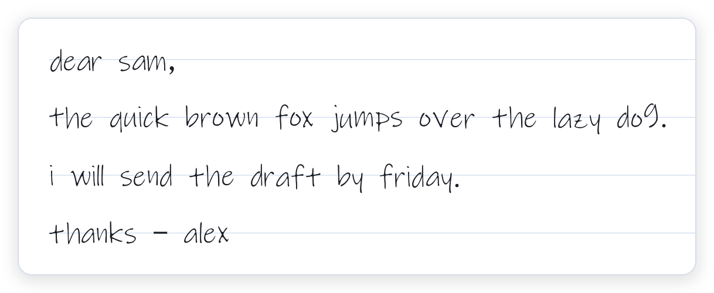
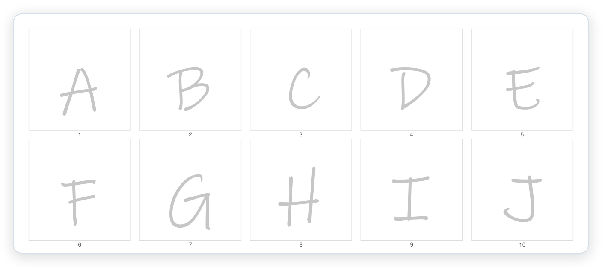
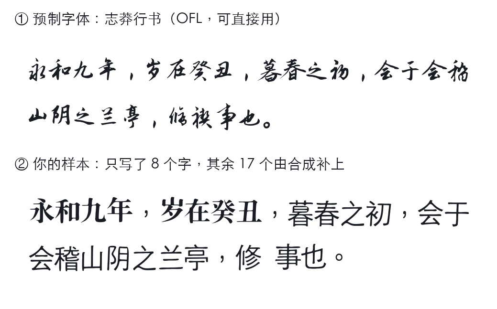
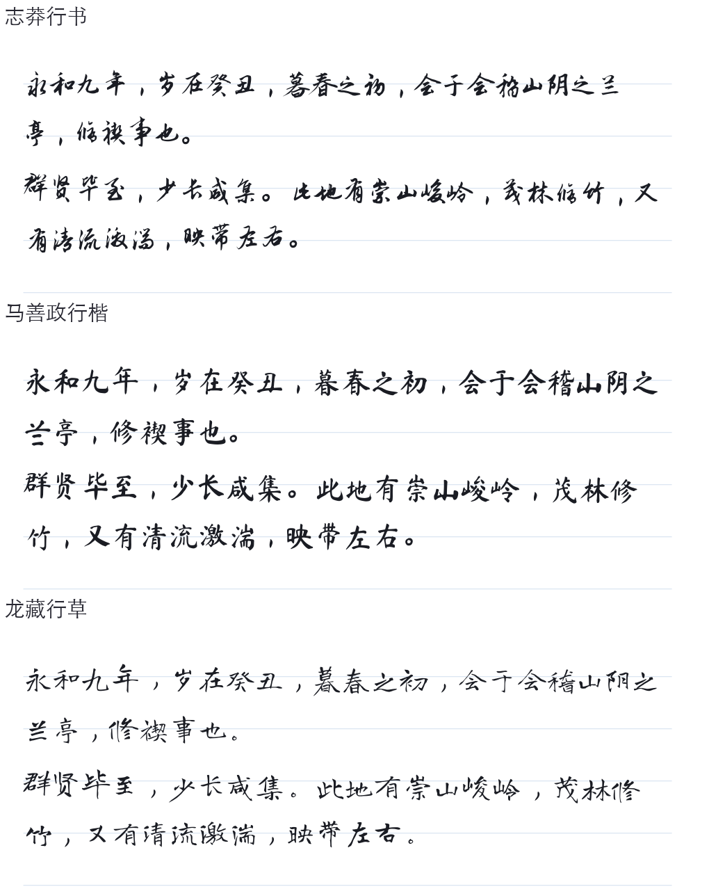
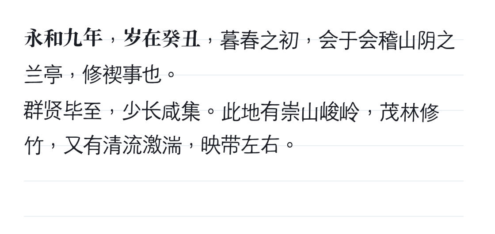
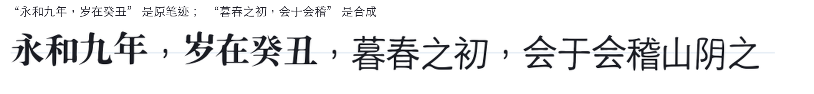

<h1 align="center"> handwriting-pdf</h1>

<p align="center">
  <b>把照片里的字迹，变成一份能打印的手写稿</b><br>
  <sub>照片 / 扫描 / PDF → 你自己的字体（.ttf）→ 排好版的 PDF｜全程本地，不联网｜Codex · DeepSeek Harness skill</sub>
</p>

<p align="center">
  
  
  
  
</p>

<p align="center"><sub><b>中文</b> · <a href="README.en.md">English</a></sub></p>

<p align="center">
  
</p>
<p align="center"><sub>示例：把 26 个字母做成字体后，用它排一封短信——横线纸、逐行抖动、墨色可调</sub></p>

## 它解决什么

大多数"手写生成器"只是换一套内置手写字体——你上传的字迹并不参与生成。这里反过来：**把你的手写描摹成矢量轮廓，做成一套真正的 `.ttf`**，再用它排版。每个字都来自你的笔尖。

- **真笔迹** —— 逐字取形、矢量化，不是字体换皮；缺字会明确告警，不会偷偷塞别的字体。
- **可复用** —— 字体可固化成 profile（字体 + 版式默认值 + 提示词），下次一句话复现同一套字。
- **全本地** —— 不联网、不上传；样张、字体、生成的 PDF 只留在你机器上。

## 三步出稿

```powershell
hwpdf template --text-file letter.txt -d hw            # 1) 按正文"去重后的字"生成练习纸
hwpdf scan hw/page1.jpg -d hw                          # 2) 拍照 → 四角定位 → 透视矫正 → 按格取字
hwpdf font -d hw --family "My Hand" -o hw/font.ttf     # 3) 矢量化成 TrueType 字体
hwpdf render --font hw/font.ttf --text-file letter.txt -o hw/letter.pdf
```

<p align="center">
  
</p>
<p align="center"><sub>练习纸由工具生成：浅灰描红字 + 整页四角的黑色定位块（拍照歪了自动矫正）；格子与字符一一对应，所以不会认错字</sub></p>

打印要点：**A4 / 100%（实际大小）**，深色笔（0.5 mm+），每格一个字，照片里四角黑块要完整。

## 两种风格来源：预制字体，或你自己的样本

<p align="center"></p>

| 来源 | 怎么用 | 适合 |
|---|---|---|
| **预制字体** | `hwpdf fonts` 列出目录，`hwpdf fonts --fetch zhimangxing` 下载（OFL-1.1，可商用可嵌入），`hwpdf render --font-name 志莽行书` | 想要好看的字，不想写样本 |
| **你的样本** | 练习纸 → `hwpdf scan` → `hwpdf font` → `hwpdf profile save`；缺字由 `synth` 按你的样本补 | 想让它**像你写的** |

两条路共用一套渲染与版面。样本那条路还做不到"以假乱真"：合成字的笔画粗细与字面大小仍会和真实字有可见差异（上图第二行：写过的"永和九年岁在癸丑"是原笔迹，其余是合成的）。样本那条路会先量你的**书写习惯**——倾角、笔重、字宽、行距抖动——再据此排版；预制字体那条路同样会量一遍，让整页保持字体自带的节奏：

```bash
hwpdf fonts                                # 目录 + 已下载的字体
hwpdf fonts --fetch zhimangxing            # 下载并校验，许可写进 LICENSES.txt
hwpdf habits --font-name 志莽行书           # 量一遍：倾斜 / 字宽 / 抖动建议
hwpdf profile save --name 我的字 --font-name 志莽行书   # 存成 profile，抖动自动取测量值
hwpdf render --profile 我的字 --text-file doc.txt -o out.pdf
```

`--jitter` 不给时会用测量值：排版体（黑体/宋体）约 0.35，真实行书约 1.5–2.0。字体只在本地，下载要显式触发，不联网也能用系统字体。

<p align="center"></p>

上面三段字是同一段《兰亭序》，只用字体本身排出来——**没有接缝，因为每个字都来自那个字体**。`--font` 接受任何 TTF/OTF/TTC（包括你在别处做好的字库），`--font-name` 只认目录里这三款。

## 只写了几个字，也能排整页（可选）

`synth` 用你写过的字估计倾斜、笔宽与比例，再印到系统骨架上——没写过的字也能按你的样子排出来。纯 CPU、不下载、不联网。

<p align="center"></p>

<p align="center"></p>

- 一条命令：`hwpdf synth build --style 你的字.ttf --charset cjk -o synth.ttf`（3755 字约 10 秒）
- 它**不是**风格迁移：字形结构来自系统无衬线骨架，只带上你的倾角、笔宽与比例；有真模型的话用 `--engine external --provider` 接进来
- 笔迹粗细可以覆盖：`synth build --weight -1…2`（默认用样本量出来的值）
- 上面那行里"永和九年，岁在癸丑"是原笔迹、"暮春之初，会于会稽"是合成——**接缝看得出来**：中文骨架是黑体，而 macOS 上没有中文手写骨架
- 细节、实测数字与已知限制：[docs/poc/stylefit.md](docs/poc/stylefit.md)

## 三种输入，按可靠性排序

| 输入 | 命令 | 说明 |
|---|---|---|
| **练习纸照片**（推荐） | `scan` | 格子坐标 ↔ 字符一一对应，没有识别环节，不会错字 |
| 已有字迹的 PDF | `extract-font` / `pdf-specimen` | 先尝试抠出嵌入字体；没有就按"文字层给标签 + 页面渲染给字形"自动收割 |
| 随手写的照片 | `segment` + `label` | 不用打印；但连笔/粘连的字切分困难，需要人工核对 |

## 安装

```bash
npx skills add atlasmarkz/handwriting-pdf@handwriting-pdf -g -y
```

或克隆后本地安装（建私有 venv、生成启动器、复制进两个宿主目录）：

```powershell
powershell -ExecutionPolicy Bypass -File .\install.ps1            # DSH + Codex
powershell -ExecutionPolicy Bypass -File .\install.ps1 -Target dsh # 只装 DSH
```

```bash
bash install.sh            # macOS / Linux，默认两个目录都装
```

## 常用命令

| 命令 | 作用 |
|---|---|
| `hwpdf doctor` | 检查依赖与系统字体 |
| `hwpdf template --text-file doc.txt -d hw` | 生成练习纸（PDF + 元数据） |
| `hwpdf scan IMG... -d hw [--append]` | 拍照 → 字形；`--append` 可事后补字 |
| `hwpdf font -d hw [--weight -2..2]` | 组装字体，可调笔画粗细 |
| `hwpdf coverage --font f --text-file doc.txt` | 列出缺字 |
| `hwpdf render --font f --text-file doc.txt -o out.pdf` | 出 PDF（`--paper`、`--jitter`、`--ink`、`--size`） |
| `hwpdf profile save --name me --font f` | 固化字迹 profile，附 `PROMPT.md` |
| `hwpdf preview --pdf out.pdf -d dir` | PDF 转 PNG，便于目检 |

可选第二引擎（实验，尚未接入真模型）：

| 命令 | 作用 |
|---|---|
| `hwpdf synth doctor` | 检查 synth 引擎、模型权重、缓存目录；未就绪时返回非零并给出安装指引 |
| `hwpdf synth build --style 字迹图.png --charset ascii [--weight N] -o hw/font.ttf` | 推断未写过的字形 → 复用矢量化 → TTF（`--charset` 支持 `ascii`/`digits`/`alpha`/`cjk`/`common3500`/`@文件`/字面字符串） |
| `hwpdf synth charsets` | 列出内置字表 |
| `hwpdf synth specimen --font hw/font.ttf --real hw/font-real.ttf -o sheet.png` | 生成字形对照表（左：你写的；右：推断的），跑模型前先目检 |
| `hwpdf synth verify --font hw/font.ttf [--charset cjk]` | 报告字体覆盖率：哪些字还得靠回退字体 |
| `hwpdf profile save --name me --font real.ttf --synth-font hw/font.ttf` | 把 synth 字体绑进 profile；之后 `render --profile me` 自动用它补没写过的字 |
| `hwpdf synth extend --font hw/synth.ttf --chars "龘"` | 往已有字库补字：只生成新字，其余从缓存重建（约 2 s，不再整库重跑） |
| `hwpdf render --profile me --grow` | 排版时遇到缺字就地补进 profile 的 synth 字体 |
| `hwpdf synth bench --style hw/font.ttf` | 量一个字形要多久：引擎 vs 矢量化，并外推到 1000 / 3755 字（CPU 预算） |
| `python scripts/train_learned.py --real hw/font.ttf -o build/style.pt` | 用自己的字现训一个 192k 参数的小模型（纯 CPU，约 2 分钟），再用 `--engine external` 接回管线 |
| `python scripts/train_vecwarp.py --real hw/font.ttf -o build/vw/style.pt` | 同一批字，但预测**位移场 + 笔画宽度**（矢量），320px 输出是锐利的；见 [docs/poc/vector-model.md](docs/poc/vector-model.md) |
| `python scripts/bench_handwriting.py build/hwfonts/ZhiMangXing-Regular.ttf --vecwarp` | 同上基准，并多跑一行矢量模型 |
| `python scripts/bench_handwriting.py build/hwfonts/ZhiMangXing-Regular.ttf` | 真实手写留出基准：拿 OFL 手写字体的 360 字当"你写过的"，比 40 个没写的字（含骨架基线） |
| `hwpdf synth eval --font hw/synth.ttf --real hw/font.ttf -o report.md` | 出评测报告：覆盖率、质量门、原样复用 IoU、倾角/笔宽是否真的印上去了 |

开发/回归：

```bash
python -m unittest discover -s tests -v     # 单元测试，0.05s，不需要 torch
hwpdf synth eval --font build/stylefit/font-all.ttf --real build/selftest/font.ttf --charset alpha
```

## 限制

- **一字一形**：没有连笔衔接、同字异形、笔压与墨色浓淡；行距/基线抖动是模拟的。
- **字库只覆盖你写过的字**：中文正文按去重字数逐字写，每页 30 格；缺字用系统楷体兜底并告警。
  `hwpdf synth` 是实验性的第二引擎。两个可用引擎：`stylefit`（解析式基线：从你写过的字量出倾角/笔宽/比例，再印到系统骨架字上——中文黑体、拉丁手写体；纯 CPU、不下载）和 `stub`（测试夹具，确定性抖动，**不是**风格迁移）。真正的少样本扩散模型（`diff-font`）还缺权重与许可（PLAN.md §8 S4），`hwpdf synth doctor` 会说清楚缺什么。
- 生成的 PDF 文字层可搜索/复制（嵌入的是真字体）。
- 仅供本人字迹的个人文稿使用；不用于签名、合同、票据、证件。

## 隐私与权重

- 图片、字体、PDF 全程不离开本机；`hwpdf` 不发起任何网络请求，也没有遥测。
- 仓库不含任何模型权重；synth 的 `stylefit` 是解析式的（零下载），`diff-font` 需要用户自行放置权重到 `~/.handwriting-pdf/models/`（`HWPDF_MODEL_DIR` 可改）。
- 候选扩散模型的权重大部分没有明确许可证（见 PLAN.md §8 S4），因此不会被随包分发；分发前需逐个确认许可。

## License

MIT

## Roadmap

少样本手写风格迁移（只给少量字迹、推断其余字形）的技术选型与分阶段计划见 [PLAN.md](PLAN.md)。
