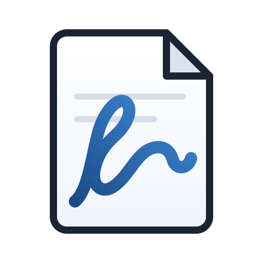
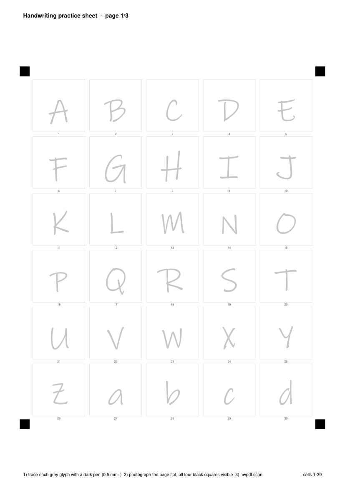
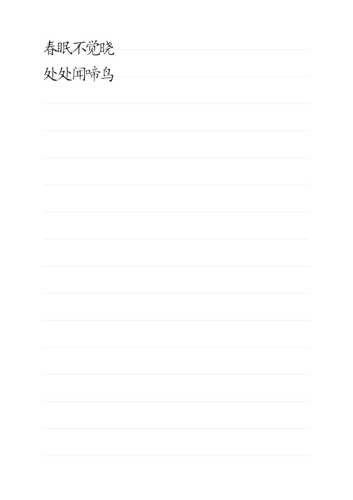

<p align="center">
  
</p>

# handwriting-pdf

照片字迹 → 可安装字体（.ttf）→ 手写风格 PDF。本地运行，不上传任何数据。
Work in Codex (`~/.codex/skills`) and DeepSeek Harness / DSH (`~/.agents/skills`).

| 练习纸（自动生成，四角定位） | 成品（用你的字迹排版） |
|---|---|
|  |  |

## 它能做什么

1. 你写（或打印练习纸后描写）几十到几百个字 → 生成一套**你自己的字体**；
2. 任意文本用这套字体排版 → 输出可打印 PDF；
3. 所有形状来自你的真实笔迹（矢量描摹），不是通用手写字体换皮；
4. 生成的字体可以固化成 **profile**，附一份 `PROMPT.md`，任何 agent 会话都能稳定复现同一套字迹与版式。

## 安装

从 GitHub 装（推荐，自动落到两个宿主目录）：

```bash
npx skills add atlasmarkz/handwriting-pdf@handwriting-pdf -g -y
```

或者克隆后本地安装（会建私有 venv、生成启动器、复制到 DSH/Codex 两个 skill 目录）：

Windows:

```powershell
powershell -ExecutionPolicy Bypass -File .\install.ps1            # 装到 DSH + Codex 两个目录
powershell -ExecutionPolicy Bypass -File .\install.ps1 -Target dsh # 只装 DSH
```

macOS / Linux:

```bash
bash install.sh            # 默认两个目录都装
bash install.sh --target codex
```

安装脚本会：在 `~/.handwriting-pdf/venv` 建一个独立 Python 环境，装好
opencv / numpy / pillow / reportlab / fonttools，生成 `bin/` 启动器，并把本 skill 复制到
`~/.agents/skills/handwriting-pdf`（DSH）和 `~/.codex/skills/handwriting-pdf`（Codex）。

## 快速验证

```powershell
.\bin\hwpdf.cmd doctor
.\bin\hwpdf.cmd selftest -d build\selftest --messy
.\bin\hwpdf.cmd preview --pdf build\selftest\demo.pdf -d build\selftest\preview
```

`selftest` 会伪造一张"拍歪了的练习纸"，跑完整条链路，产出 `demo.pdf`。

## 用法

```powershell
# 1) 生成练习纸（只包含文档需要的字）
.\bin\hwpdf.cmd template --text-file letter.txt -d hw
# 2) 打印 → 用深色笔描写灰字 → 拍四角可见的照片 → 扫描
.\bin\hwpdf.cmd scan hw\page1.jpg -d hw
# 3) 造字体
.\bin\hwpdf.cmd font -d hw --family "My Hand" -o hw\font.ttf
# 4) 查覆盖 + 出 PDF
.\bin\hwpdf.cmd coverage --font hw\font.ttf --text-file letter.txt
.\bin\hwpdf.cmd render --font hw\font.ttf --text-file letter.txt -o hw\letter.pdf --size 12 --paper ruled
# 5) 转图片自检
.\bin\hwpdf.cmd preview --pdf hw\letter.pdf -d hw\preview --dpi 150
```

### 已经有一份"我的字迹"PDF？

```powershell
# 优先：直接从 PDF 里抠出嵌入的字体（最保真）
.\bin\hwpdf.cmd extract-font --pdf my-handwriting.pdf -d hw
# 退一步：PDF 有文字层时，按"文字层给标签 + 页面渲染给字形"自动收割每个字
.\bin\hwpdf.cmd pdf-specimen --pdf my-handwriting.pdf -d hw
.\bin\hwpdf.cmd font -d hw --family "My Hand" -o hw\font.ttf
# 扫描版 PDF：先转图，再走 segment/label
.\bin\hwpdf.cmd rasterize --pdf my-handwriting.pdf -d hw\pages
```

### 把字体固化成 profile（以后一句话复用）

```powershell
.\bin\hwpdf.cmd profile save --name me --font hw\font.ttf --source "my-handwriting.pdf"
.\bin\hwpdf.cmd render --profile me --text-file letter.txt -o letter.pdf
```

profile 保存在 `~\.handwriting-pdf\profiles\me\`：`font.ttf` + `profile.json`（含 SHA-256、默认版式）
+ `PROMPT.md`（可粘给任何 agent 的提示词）。详见 [references/profile.md](references/profile.md)。

## 目录

```
SKILL.md               agent 使用说明（Codex / DSH 都读这个）
bin/hwpdf.cmd|hwpdf    启动器（安装时生成）
scripts/hwpdf.py       CLI 入口
scripts/imaging.py     读图、光照归一化、二值化、切分、缩略图
scripts/scan.py        练习纸四角定位、透视矫正、按格取字
scripts/vectorize.py   轮廓追踪 → 字形矢量
scripts/fontbuild.py   度量估计（基线/字号）→ 组装 TTF
scripts/render.py      文本换行 + 手写抖动 → PDF
scripts/templategen.py 练习纸 PDF 生成
references/            细节流程与排错
```

## 贡献者

| 角色 | 贡献者 |
|---|---|
| 需求、字迹样本、验收 | [atlasmarkz](https://github.com/atlasmarkz) |
| 调研、设计、实现、测试、文档 | DeepSeek AI（deepseek-v4.1-flash） |

详见 [CONTRIBUTORS.md](CONTRIBUTORS.md)。本项目由人类与 AI agent 协作完成：agent 起草并验证，仓库所有者复核后发布。

## 限制

- 一个字符只有一个字形：没有连笔、没有同字不同形、没有笔压。
- 字库只覆盖你写过的字；缺失字符用中性手写字体兜底并会告警。
- 中文需按文档去重后的字数逐字手写（每页 30 格）。
- 仅供本人字迹与个人文稿；不用于签名、合同、票据、证件。
