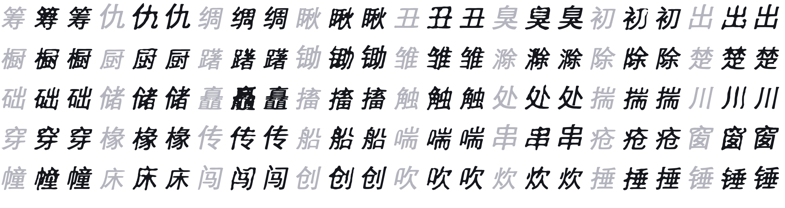
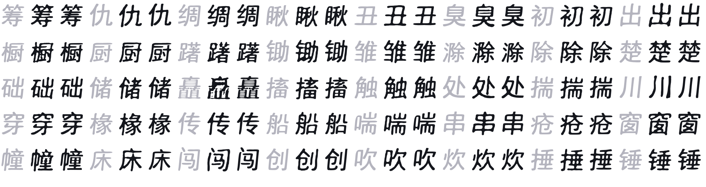

# 每用户小模型 PoC：本地训练、纯 CPU、不碰任何第三方权重

S4 想接的是公开的少样本模型（FontDiffuser / Diff-Font / HWT），但它们除 zi2zi 外许可证空白，
不能分发权重。于是先做了**路线 B 的最小可行版本**：不下载任何权重，用你自己的 100–400 个字形
现训一个 192k 参数的小网络，学"骨架字 → 我的字"。

这样做的额外好处是它回答了上一个问题：**CPU 够不够**。够——训练 2 分钟，推理 15 ms/字。

## 怎么跑

```bash
# 1. 概括：把你的字迹做成字体（v0.1 的 scan/font 路径，或者任意已有字体）
# 2. 训练（默认 64×64，30 epoch，360 个字形约 2 分钟，纯 CPU）
python scripts/train_learned.py --real hw/font.ttf -o build/learned/style.pt

# 3. 推理：作为 provider 接回整条管线（质量门、缓存、TTF、排版全都复用）
hwpdf synth build --engine external --provider examples/provider_learned.py \
  --chars "春风又绿江南岸" -o build/learned/model.ttf

# 4. 对比
hwpdf synth eval --fonts build/learned/model.ttf build/learned/stylefit.ttf \
  --real hw/font.ttf --charset @build/learned/testset.txt --sheet build/learned/sheet.png
```

## 实验设计

没有真实用户手写样本时，无法公平评测"泛化到没写过的字"。所以用一个**合成写手**当代理：
`examples/provider_writer.py` 把系统黑体的每个字按固定规则加工，保证训练集和测试集用同一个"人"。

- 400 个常用字，**前 360 训练、后 40 留出**（训练脚本按字体 cmap 自动取交集，缺字不会被误当成 .notdef 学进去）；
- 两种写手：
  - `affine`：整体右倾 0.20 + 统一加粗 1.6 px —— 全局仿射；
  - `strokes`：倾斜减半，但**只加粗横画**（局部规则，全局仿射表达不了）。
- 模型：64×64 单通道，3 次下采样 + 跳连，192k 参数；AdamW + OneCycle，30 epoch。





## 结果（40 个留出字的 IoU，越高越好）

| 写手 | 小模型 | stylefit（解析式） | 结论 |
|---|---|---|---|
| affine | 0.724 | **0.954** | 解析式几乎复刻 |
| strokes | 0.793 | **0.951** | 局部加粗也没难住解析式 |
| affine, 128×128 / 30 epoch | 0.715 | — | 提高分辨率**没有**帮上忙 |

三个结论，按重要性排序：

1. **在这个代理任务上，学出来的模型输给了不用学的模型。** 原因是代理的"风格"本质是一个全局变换，
   stylefit 精确建模了它；小网络输在几何保真（64×64 有模糊、偶发色块），而不是输在"没学会风格"。
2. **提高分辨率不自动更好**：128×128 在同样 30 epoch 下反而低 0.08，因为每像素的有效样本变少了。
   想让学出来的模型赢，得改**表示**而不是改分辨率——比如预测笔画骨架上的位移/宽度（矢量），
   而不是猜像素；或者把模型放进"多次迭代细化"的循环里。
3. **真正的差距要真实手写才能测出来。** 真人写字不是对系统字体的仿射变换：笔画顺序、连笔、结构
   都会变，那时解析式会明显见顶。这个 PoC 只证明了管线是通的、CPU 是够的，**没有**证明小模型值得上。

## 成本

| 项 | 数字 |
|---|---|
| 训练数据 | 360 个字形，0.1 s 渲染 |
| 训练 | 30 epoch，**120 s**（M4，CPU，10 线程），loss 0.099 |
| 推理 | 68 个字形 **0.99 s**（≈15 ms/字，含 PIL 渲染与描轮廓） |
| 模型体积 | 192k 参数 ≈ 0.8 MB（fp32） |
| 依赖 | 仅 `torch`（`requirements-synth.txt`），无网络、无权重下载 |

## 许可与隐私

- 训练数据只来自你自己的字迹字体；**没有任何第三方权重**参与，产出的 `.pt` 可以自由处置。
- 反过来：想让模型见过真正的"别人的笔迹"，就需要公开数据集或公开权重 —— 那一步仍然卡在
  §8 S4 的许可问题，没有被这个 PoC 绕过去。
- `hwpdf synth build --engine external` 的缓存键包含 provider 文件内容与 `HWPDF_*` 环境变量，
  换模型或换参数不会误用旧字。
