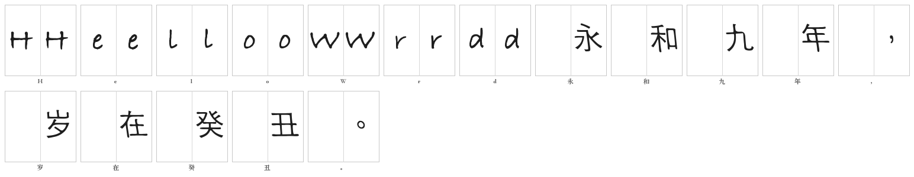
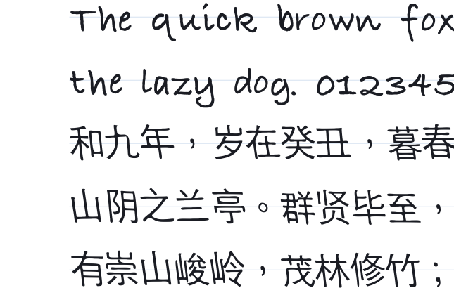
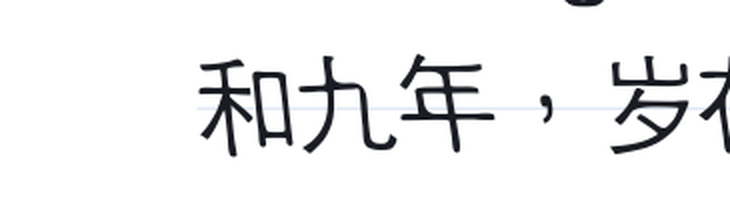

# PoC：`stylefit` 解析式基线（S4 之前的对照点）

> 结论先说：`stylefit` 不是风格迁移。它只学四样能测的东西——倾角、笔宽、x 高、字宽比例——把它们印到系统骨架字上。你写过的字原样复用；没写过的字保持骨架字的结构，带上你的倾斜和粗细。
>
> 2026-11-11 修正：骨架默认改成**无衬线（黑体）**。同一套倾斜/粗细参数下，宋体的三角顿笔即使被斜切也还是印刷体观感，黑体的统一笔宽更接近钢笔。见下面的对照与「骨架怎么选」。

## 它做什么

1. 用你写的字（`--style <你的字体.ttf>`）渲染取样：拉丁 `xnoaehgpds`、中文 `永和九年岁在癸丑上下中今`（取实际存在的）。
2. 列投影方差扫描 −0.30..+0.30 估倾角；墨水比 → 笔宽（腐蚀/膨胀 −1..+2 级）；高宽比 → y/x 缩放（夹在 0.85–1.15）。
3. 对每个没写过的字：系统骨架字（中文黑体 / 拉丁 Bradley Hand）→ 仿射（倾角+缩放+±0.6° 抖动）→ 形态学调粗细 → 出界就整体平移回格内。
4. 你写过的字直接画原字形，不做近似。
5. 中文没有样本时借用拉丁测出的倾角与笔宽（同一个人的手是同一个倾斜），骨架仍是系统黑体。

## 复现

```bash
# 1) 用你写的字当风格源（这里用 selftest 生成的练习字体当例子）
hwpdf synth build --style build/selftest/font.ttf \
  --charset @build/stylefit/charset-all.txt -o build/stylefit/font-all.ttf --engine stylefit

# 2) 数值评测：覆盖率 / 质量门 / 原样复用 IoU / 倾角 / 笔宽
python scripts/eval_synth.py --font build/stylefit/font-all.ttf \
  --real build/selftest/font.ttf --charset alpha -o build/eval/report-alpha.md

# 3) 目检：左"你写的"、右"推断的"
hwpdf synth specimen --font build/stylefit/font-all.ttf --real build/selftest/font.ttf \
  --chars "Helo Wrd 永和九年" -o build/stylefit/spec.png

# 4) 换骨架对照（可选）：HWPDF_SKELETON=/path/font.ttc#0，HWPDF_SKELETON_STYLE=sans|serif|hand
HWPDF_SKELETON="/System/Library/Fonts/Supplemental/Songti.ttc#0" hwpdf synth build \
  --style build/selftest/font.ttf --charset "永和九年" -o build/songti-test.ttf --no-cache

# 5) 真正排一页
hwpdf render --font build/selftest/font.ttf --fallback build/stylefit/font-all.ttf \
  --text "The quick brown fox jumps over the lazy dog 0123. 永和九年，岁在癸丑，暮春之初，会于会稽山阴之兰亭。" \
  -o build/stylefit/page-all.pdf --size 24
```

## 2026-11-11 的实测（macOS 27 / M 系，纯 CPU）

| 指标 | 结果 |
|---|---|
| 字库规模 | 3877 字（ASCII + GB2312 一级 3755 + 中文标点），**9.1 s** |
| 质量门 | passed 3877 / rejected 0 / retried 0 |
| 原样复用（你写过的字） | 归一化 IoU **0.938**（1.0 = 像素级一致；差异来自 TTF 量化与包围盒归一） |
| 倾角 | 真实 **+0.20** → 生成 **+0.16**（拟合把倾斜印上去了） |
| 平均墨水填充 | 真实 **0.463** → 生成 **0.477**（略粗一点） |
| 覆盖率 | ASCII 40/40、GB2312 3755+ 全部 100% |

## 观感（图在 `docs/poc/`）



左格 = 你写的，右格 = 推断的。你写过的字（H/e/l/o/W/r/d）两格一致；中文格是黑体骨架 + 你的倾斜，笔画圆头、没有衬线。



拉丁部分是可信的手写观感；中文部分是「斜的、略粗的圆头黑体」——像马克笔写的，不再像宋体印刷体。



放大看，中文确实带上了倾角和粗细，但笔画形状、连笔、结构重心全是宋体的。

## 为什么它不是 S4

- 学不到**笔画粗细变化**（横细竖粗）、**连笔/牵丝**、**结构变形**（左低右高、部件比例）。
- 中文在没有中文样本时只是"斜的宋体"，离"像我写的"很远。
- 它的价值：① 零下载、零 GPU、确定性，今天就能用；② 给 S4 的扩散模型一个可量化的对照（同样输入，比 IoU/倾角/笔宽之外还要比"像不像"）。

## 修正记录：一个被骨架掩盖的 bug

这一轮换骨架时挖出两个真问题，都值得记住：

1. `glyphs_of()` 读 `.ttc` 没传 `fontNumber`，fontTools 返回空 cmap，于是**任何 TTC 骨架都被判定为「没有这个字」**，静默回退到探测表第一名（宋体）。骨架选择功能形同虚设，看不出异常——因为它退回的地方正好是原来默认的地方。
2. 因此 `HWPDF_SKELETON` 覆盖开关第一次实测时「日志说生效了、字形没变」；修好 cmap 后才得到宋体/黑体的对照。

**骨架怎么选**：`STYLE_SCORE`（楷 > 宋 > 黑）是给练习纸描红用的——描红越像字帖越好。synth 的取向相反：要像「用笔写的」，所以 CJK 默认挑黑体（`HWPDF_SKELETON_STYLE=serif|hand` 可改），拉丁仍优先真手写体。系统里若有楷体，它仍是最佳骨架。

## 修正记录：标点与降部曾经被钉在同一条基线上

`fontbuild._row_baselines()` 把每个字的**墨迹底部**对齐到同一条基线——对"每个格子里写一个字"的 v0.1 路径是对的，对手写风格的合成字是错的：

- `，` 的墨迹本来就悬在基线上方约 0.19 em（黑体实测），钉到基线后变成"浮在字与字之间"；
- 拉丁 `y g p q` 的降部被压平，字看起来踩在一条线上。

修法：引擎在 glyph 的 `meta` 里报出它自己画字的 `baseline_px` 与 `em_px`，`fontbuild` 有这两个值就按真实基线换算（`s = EM / em_px`），没有就维持原来的格子基线——v0.1 的扫描路径完全不受影响。缓存只存 mask，所以 `Engine.ink(size)` 在缓存命中时重新提供这组数。

对照实测（120 px，em=1000）：「永和九年，岁在癸丑。」里逗号前后空隙，黑体参考 60/62 px，修正后 55/64 px；修正前是 8/111 px——一度把 `，` 贴到了前一个字上。

## 已知限制

- 骨架字决定结构：macOS 只装了宋体与黑体，换不成楷体/行书；黑体+倾斜是「马克笔」观感。
- 没有笔压变化：粗细是全局形态学膨胀，不是每笔的提按；横细竖粗、起收顿挫学不到。
- 单一全局倾角：不区分"竖画倾斜"和"整体斜体"，对楷书这类竖画正直的字体会低估。
- 出界靠平移修正，极端字形（超长竖钩）仍可能被裁。
- 无连笔，字距是独立的（排印时靠 `--tracking` 与抖动补一点自然感）。
