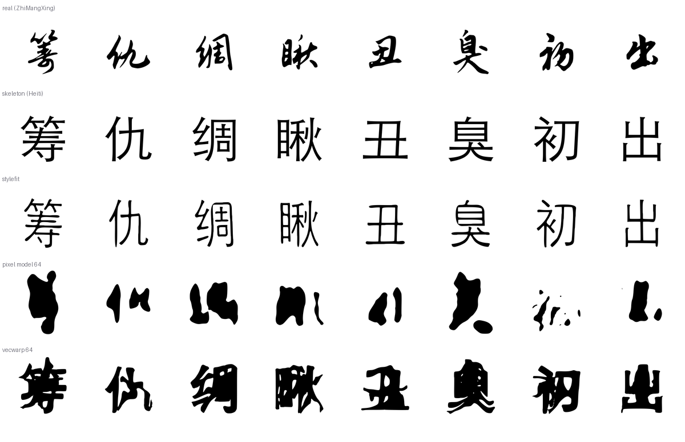

# 矢量表示的小模型：位移场 + 笔画宽度

上一份报告（`real-handwriting.md`）的结论是"瓶颈是表示，不是分辨率"：像素模型在 64×64 上
预测灰度图，怎么放大都是糊的。这份报告把它换成矢量输出——模型不再猜像素，而是给出造字
**真正需要的两个量**：

    (dx, dy)   骨架上的每个点应该往哪里挪     （64×64 的平滑场）
    w          那个点的笔画有多粗             （1–6 px）

渲染完全在矢量/距离场域完成：把骨架的距离变换按位移场扭一下，保留 `距离 ≤ w` 的像素。
上采样的只有两个平滑场，而平滑场可以无损放大，所以 320px 输出的边缘是锐的。

```bash
python scripts/train_vecwarp.py --real your-font.ttf -o build/vw/style.pt
HWPDF_VECWARP=build/vw/style.pt ./bin/hwpdf synth build --engine external \
    --provider examples/provider_vecwarp.py --style your-font.ttf --charset cjk
```

## 结果（40 个留出字，aligned IoU）

| 字体 | 骨架基线 | stylefit | 像素模型 64 | **矢量模型 64** |
|---|---|---|---|---|
| Zhi Mang Xing | 0.213 | 0.218 | 0.263 | **0.280** |
| Ma Shan Zheng | 0.276 | 0.242 | 0.327 | **0.369** |
| Long Cang | 0.222 | 0.187 | 0.193 | **0.249** |

它是目前唯一在三套字体上**全部高于骨架基线**的方法，也比像素模型稳定高出 0.02–0.06。



上图每行：真值、黑体骨架、stylefit、像素模型、矢量模型。像素模型那一行是它在 320px 下的
实际输出——64×64 的灰度被放大后连笔画都连不成形；矢量模型输出的是完整、锐利的字形，
形状仍然不对，但至少是"字"。

## 四个发现

1. **分辨率不是瓶颈，表示才是。** 把场提高到 128×128（`--base 128`）反而更差
   （0.253 vs 0.280），和像素模型 128px 的结论一致。
2. **拟合能力也不是瓶颈。** 200 epoch 把训练集 IoU 从 0.576 推到 0.633，留出集从 0.280
   掉到 0.278：多出来的容量全部用来记住那 360 个字，没有换来泛化。
3. **矢量输出的价值在"锐利且可控"**：渲染是距离场阈值，天然抗锯齿、任意分辨率都清晰，
   而且输出直接就是轮廓（进 `fontbuild` 前不用再矢量化）。这解释了为什么它的分数只高
   一点点、观感却好得多。
4. **还剩的结构差距是平滑场表达不了的**：行书的连笔、起收笔的粗细变化、部件之间的错位，
   都需要"笔画级"的对应关系（哪一横对应哪一横），而不是一个逐点的位移。

## 两个值得记下来的 bug

- **距离变换用反了。** `cv2.distanceTransform(mask, ...)` 算的是"到最近零像素的距离"，
  即以墨迹为背景：结果是**背景为 0、笔画内部变大**。第一版直接拿它当"到骨架的距离"，
  于是 `距离 ≤ w` 选中的全是背景，模型学了 60 epoch 仍停在 IoU 0.09。正确输入是
  `distanceTransform(1 - mask)`：骨架上为 0，向外增大。
- **画布外必须当成"很远"。** `grid_sample` 默认零填充，而零恰好是"骨架上"，
  于是边界处整片被当成墨迹，宽度塌到最小、位移饱和。现在采样越界的地方用 40 顶替。

## 复现

```bash
# 三个字体，每个都会打印骨架/stylefit/像素/矢量四行
for f in ZhiMangXing MaShanZheng LongCang; do
  python scripts/bench_handwriting.py build/hwfonts/$f-Regular.ttf --size 64 --epochs 60 --vecwarp
done

# 分辨率与训练量的对照
python scripts/train_vecwarp.py --real <user.ttf> --base 128 -o build/vw/128.pt
python scripts/train_vecwarp.py --real <user.ttf> --epochs 200 -o build/vw/200.pt
```

训练成本：360 个字、60 epoch、M4 CPU 8 线程约 **15 s**；推理约 **1 ms/字**（320px 渲染
含距离变换与重映射）。权重 0.4 MB。
